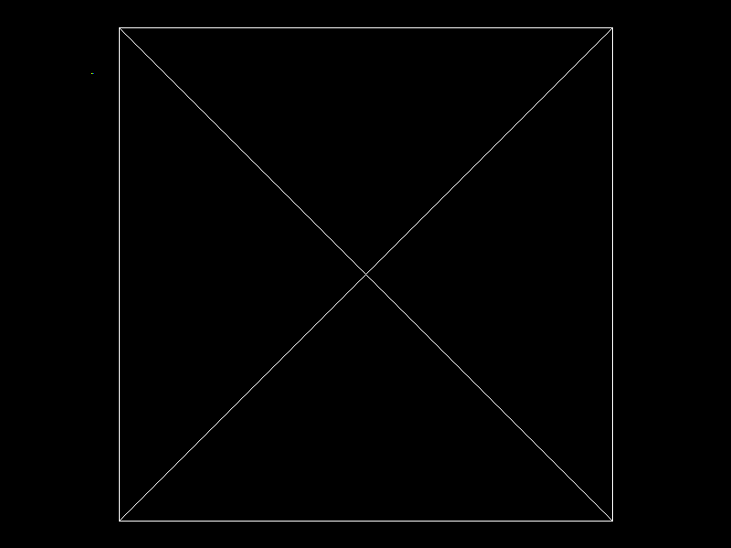

# Proyecto 1 — Parte 2: Rellenando triángulos

Renderer hecho desde cero en Rust. Carga una esfera `.obj`, recorre sus triángulos y aplica un shader procedural por fragmento en un framebuffer propio, sin usar las funciones de Raylib para dibujar modelos 3D.

## Resultado



Las flechas orbitan la cámara; `W`/`S` acercan o alejan y `A`/`D` desplazan el objetivo.

El planeta usa una luz direccional para separar el día y la noche. En el hemisferio nocturno aparecen luces cálidas procedurales agrupadas sobre las zonas terrestres.

Para mantener fluido el renderizado, el framebuffer se limita a 1280×720 y se escala a pantalla completa. El perfil de desarrollo también usa optimización (`opt-level = 2`), así que `cargo run` no ejecuta el rasterizador sin optimizar.

## Cómo funciona

```
Archivo OBJ -> Vértices + índices -> Triángulos -> Fragmentos interpolados -> Shader procedural -> Framebuffer
```

- `object.rs`: `load_obj` lee el archivo y devuelve vértices e índices de triángulos (base 0).
- `triangle.rs` y `rasterizer.rs`: generan fragmentos y mezclan posición y normal dentro de cada triángulo.
- `planet.rs`: aplica el patrón rocoso con iluminación y borde atmosférico.
- `main.rs`: carga `model/sphere.obj`, proyecta la malla y usa un buffer de profundidad para resolver superficies superpuestas.

## Cómo ejecutar

```
cargo run --release
```
## Modelo utilizado

`model/object.obj`

## Algoritmos de rellenado

### Algoritmo 1: Coordenadas baricéntricas

Se basa en calcular un cuadro delimitador (bounding box) alrededor del triángulo y evaluar, para cada píxel dentro de él, si pertenece al interior de la figura usando pesos baricéntricos.

### Algoritmo 2: Lineas horizontales

Avanza una fila a la vez, calcula las intersecciones de la fila con los lados del triángulo y genera fragmentos entre los extremos del tramo interior.


## Resultados del benchmark


| Algoritmo | Mediana de 7 muestras de 100 rasterizaciones | Fragmentos por rasterización |
| --------- | --------------------------------------------- | ---------------------------- |
| Baricéntrico | 851.636097 ms | 129030 |
| Scanline | 680.072074 ms | 129030 |

Las mediciones corresponden a un triángulo grande y dependen del equipo y de la carga del sistema.

## Perfilado

El modo `--benchmark-triangles` rasteriza repetidamente el triángulo y termina sin abrir la ventana. Para medirlo con `cargo-flamegraph` y `perf` instalados:

```bash
cargo flamegraph -- --benchmark-triangles
```

El comando genera `flamegraph.svg` en la raíz del proyecto.

```bash
cargo run --release -- --benchmark-triangles
```
