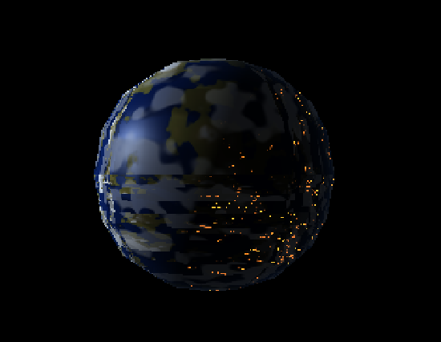
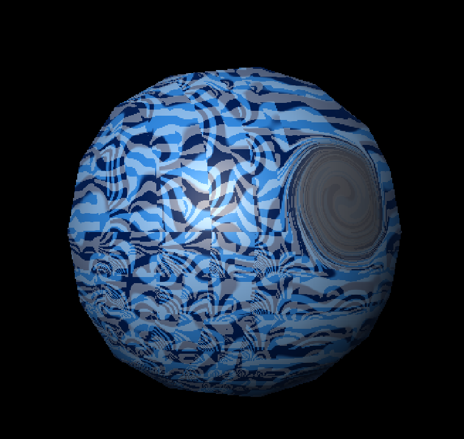
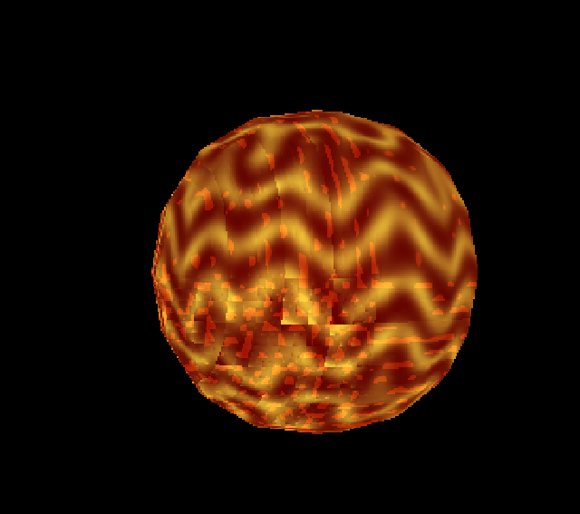

# Planetas y estrella con shaders procedurales

Renderer 3D hecho en Rust. Carga una esfera desde un archivo OBJ y colorea sus fragmentos con shaders procedurales propios. Raylib gestiona la ventana, la imagen y la textura; la transformación, el ensamblado, la rasterización, la iluminación y los patrones se implementan en el proyecto.

## Repositorio

[github.com/jdivass/shaders](https://github.com/jdivass/shaders)

El repositorio incluye el código Rust, `Cargo.toml` y `Cargo.lock`, y la malla necesaria en `model/sphere.obj`.

## Compilar y ejecutar

Desde la carpeta `shaders`:

```bash
cargo run --release
```

La ventana se centra en el monitor actual y ocupa el 70% de su ancho y el 70% de su alto. El renderer limita su resolución interna a 1280×720 y escala la imagen para ajustarla a la ventana.

## Selección y controles

- `1`: planeta rocoso.
- `2`: gigante gaseoso.
- `3`: estrella.
- `Page Up` / `Page Down`: aumenta o reduce la cobertura de nubes del planeta rocoso.
- Flechas: orbita la cámara.
- `W` / `S`: acerca o aleja la cámara.
- `A` / `D`: desplaza el objetivo horizontalmente.

## Cuerpos celestes

### Planeta rocoso


Usa ruido 3D interpolado y una suma de octavas (`fbm`) para crear variaciones de altura. Un corte suave mezcla océano y tierra; otro umbral añade nieve en las zonas altas. Una luz direccional define día y noche. Las ciudades se forman al combinar una máscara de tierra, regiones de ruido de baja frecuencia y puntos de alta frecuencia; solo se ven en el hemisferio nocturno. El océano tiene reflejos especulares y los continentes una respuesta mate.

Las nubes combinan ruido a escalas `6` y `12` con pesos `0.65` y `0.35`. Su desplazamiento depende del tiempo y no altera el patrón del terreno. La misma máscara, desplazada según la dirección de la luz, produce las sombras sobre la superficie.

Parámetros principales en `src/planet.rs`:

- `fbm(p * 4.0)`: escala del patrón continental. Aumentarla crea formas más pequeñas.
- `smoothstep(0.48, 0.52, height)`: umbral y suavidad de las costas.
- `smoothstep(0.65, 0.78, height)`: umbral de nieve.
- `cloud_coverage`: cobertura ajustada con Page Up y Page Down.
- `0.08` en `shadow_offset` y `0.58` en `direct_light`: desplazamiento e intensidad de las sombras de nubes.

### Gigante gaseoso



Las bandas nacen de una onda basada en la coordenada vertical de la esfera, deformada por ruido 3D. Un segundo patrón genera bandas finas. Una tormenta ovalada se coloca sobre la superficie; alrededor de ella, una rotación localizada de las coordenadas curva las bandas y su ruido para formar el vórtice. El patrón cambia con el tiempo para simular movimiento atmosférico.

Parámetros principales en `shade_gas_giant`, dentro de `src/planet.rs`:

- `warped_position.y * 30.0`: cantidad y escala de las bandas anchas.
- `turbulence * 3.0`: deformación irregular de las bandas.
- `warped_position.y * 78.0`: frecuencia de las bandas finas.
- Los dos `Vector3` del `mix` principal: colores alternos de las bandas, en componentes RGB normalizados entre `0.0` y `1.0`.
- `storm_center`: ubicación del vórtice; `0.40` y `10.05` en `warp_into_vortex` controlan el radio de influencia y la rotación.
- `storm_color`: color del centro de la tormenta.

### Estrella



La estrella es autoluminosa y no usa el ciclo de día y noche de los planetas. Combina ondas deformadas, celdas sinusoidales y ruido en un valor de calor que mezcla tonos rojos y amarillos. Otra máscara de ruido crea zonas de erupción y un gradiente en el borde da volumen a la esfera. Los patrones se animan con el tiempo.

Parámetros principales en `shade_star`, dentro de `src/planet.rs`:

- `fbm(p * 5.0 + drift)`: escala y movimiento del plasma.
- `p.y * 24.0` y `p.x * 31.0 + p.z * 17.0`: frecuencia de ondas y celdas.
- Los dos `Vector3` del `mix`: colores fríos y calientes de la superficie.
- `noise(p * 16.0 + drift)`: tamaño de las zonas de erupción.

## Animación

Los patrones de la estrella, las bandas del gigante gaseoso, el vórtice y las nubes están animados. Todas estas animaciones pueden verse en el siguiente video:


## Cómo funciona el renderer

```text
model/sphere.obj → vértices → transformación y proyección → triángulos → fragmentos → shader → framebuffer
```

`src/object.rs` carga y triangula la malla OBJ. `src/shaders.rs` proyecta los vértices. `src/triangle.rs` y `src/rasterizer.rs` generan fragmentos e interpolan sus atributos. `src/planet.rs` calcula los patrones, colores e iluminación de cada cuerpo celeste. `src/framebuffer.rs` almacena los píxeles y los presenta en la ventana.
